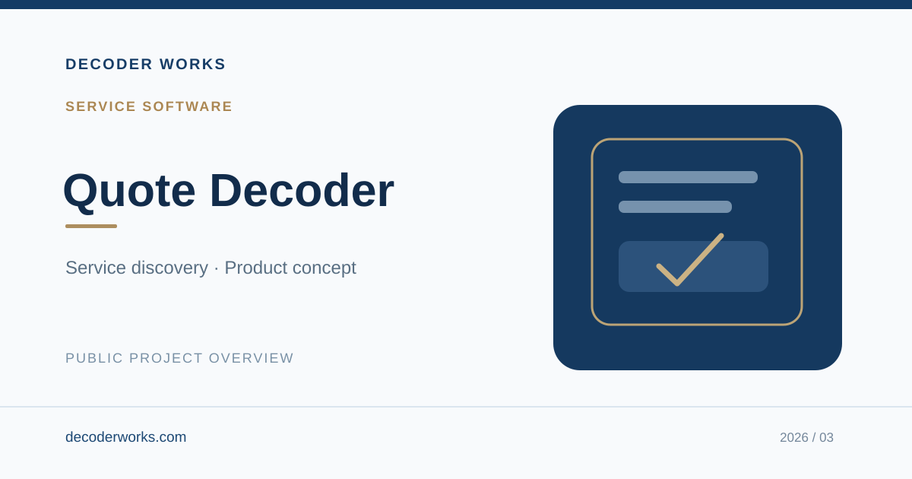

# Quote Decoder

**Service Software · Product Concept & Development**

A digital product concept focused on making service discovery and early-stage quote requests simpler and more understandable.

## Key Use Cases

- Help people explore available service options with greater clarity.
- Simplify the initial experience of requesting a quote.
- Encourage clearer communication between customers and service providers.

## My Contribution

Product ideation, experience strategy, interface design, and prototype development.

## Project Access

**Portfolio:** Public overview only  
**Working application:** Private  
**Source code:** Not publicly available

This showcase is intentionally limited to the project's purpose and intended user value. Internal matching logic, pricing methods, implementation details, business operations, integrations, and confidential information are not disclosed. The cover is illustrative, not a production screenshot.

## More Information

**Website:** [decoderworks.com](https://decoderworks.com)  
**Email:** [info@decoderworks.com](mailto:info@decoderworks.com)

---

*© 2026 Decoder Works. Public portfolio summary only. No software license is granted.*
